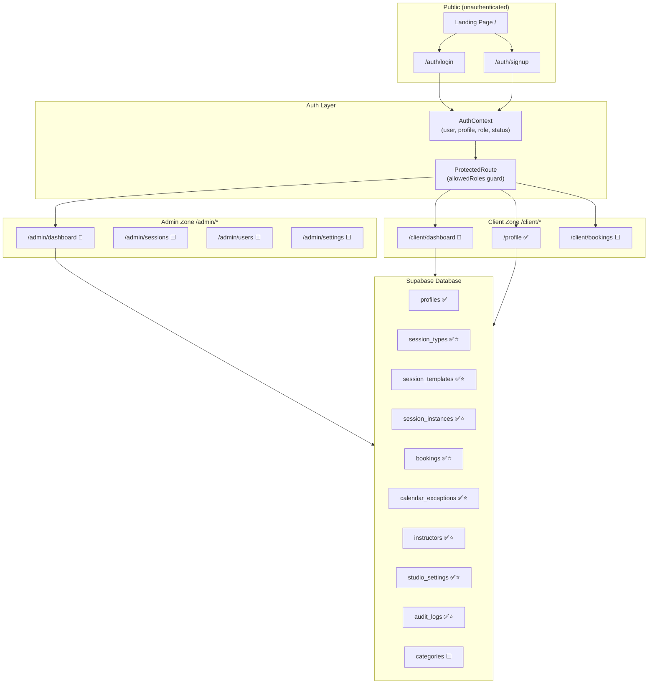

# Yoga Córdoba (TRW) — Full Implementation Plan
*Last updated: 2026-11-06 · Aligned with tutorial + all custom additions preserved*

---

## Audit Legend
| Symbol | Meaning |
|--------|---------|
| ✅ | Done — implemented and working |
| 🔧 | Partial — scaffolded but incomplete |
| ⬜ | Not started — tutorial requirement |
| ⭐ | Custom addition — beyond the tutorial |

---

## 1. Project Foundation

### Tech Stack
- **Framework:** Next.js 16 (App Router) with TypeScript ✅
- **Styling:** Tailwind CSS v3 + custom design tokens (sage, ivory, ink, clay) ✅ ⭐
- **Auth & DB:** Supabase (Auth + PostgreSQL + Storage) ✅
- **Icons:** Lucide React ✅
- **Monitoring:** Sentry (edge + server instrumentation) ✅ ⭐
- **Analytics:** Vercel Analytics ✅ ⭐
- **Fonts:** Fraunces (display) + Inter (body) — no-flash theme script ✅ ⭐
- **Missing:** Recharts (needed for Phase 5 reporting charts) ⬜

---

## 2. Database Schema (Supabase)

> [!IMPORTANT]
> Our schema is a **superset** of the tutorial. Every tutorial table is covered,
> but we model sessions with the template → instance pattern instead of a single flat `sessions` table.

### 2a. Tables — Tutorial vs Ours

#### `profiles` ✅
| Tutorial field | Our field | Status |
|----------------|-----------|--------|
| `id` uuid (references auth.users) | `id` UUID PK → auth.users CASCADE | ✅ |
| `first_name` text | `first_name` TEXT | ✅ |
| `last_name` text | `last_name` TEXT | ✅ |
| `avatar_url` text | `avatar_url` TEXT | ✅ |
| `role` user_role (default 'user') | `role` user_role ENUM ('user','client','admin') | ✅ |
| `created_at` timestamp | `created_at` TIMESTAMPTZ | ✅ |
| `phone_prefix` text | `phone_prefix` VARCHAR(10) default '+34' | ✅ |
| `phone_number` text | `phone_number` TEXT | ✅ |
| `address_line1` text | `address_line1` TEXT | ✅ |
| `address_line2` text | `address_line2` TEXT | ✅ |
| `post_code` text | `post_code` VARCHAR(20) | ✅ |
| `city` text | `city` TEXT | ✅ |
| `county` text | `county` TEXT | ✅ |
| `country` text | `country` TEXT default 'España' | ✅ |
| — | `status` user_status ('active','banned','rejected') | ⭐ |
| — | `full_name` TEXT (computed on sign-up) | ⭐ |
| — | `phone` TEXT (mirror field for compatibility) | ⭐ |
| — | `preferred_lang` VARCHAR(5) default 'es' | ⭐ |
| — | `emergency_contact_name` TEXT | ⭐ |
| — | `emergency_contact_phone` TEXT | ⭐ |
| — | `health_notes` TEXT | ⭐ |
| — | `notes` TEXT (admin-only) | ⭐ |
| — | `first_booking_at` TIMESTAMPTZ | ⭐ |
| — | `updated_at` TIMESTAMPTZ | ⭐ |

#### `categories` ⬜ → Replaced by `session_types` ⭐
> The tutorial uses a separate `categories` table that `session_types` references via `category_id`.
> **Our design merges these** — `session_types` acts as both category and type (with slug, i18n names, etc.).
> To align with the tutorial, **add a `categories` table** (see §2b "Phase 2 Gaps").

| Tutorial field | Our equivalent |
|----------------|---------------|
| `id` uuid | — (not a separate table) |
| `name` text | `session_types.name` |
| `description` text | `session_types.description` |
| `created_at` timestamp | `session_types.created_at` |

#### `session_types` ✅ ⭐ (Enhanced beyond tutorial)
| Tutorial field | Our field | Status |
|----------------|-----------|--------|
| `id` uuid | `id` UUID PK | ✅ |
| `category_id` uuid (→ categories) | — (merged into one table) | ⭐ |
| `name` text | `name` + `name_es` + `name_en` (i18n) | ✅ ⭐ |
| `description` text | `description` + `description_es` + `description_en` | ✅ ⭐ |
| `base_price` numeric | — (price lives on template/instance) | 🔧 |
| `is_active` boolean | `is_active` BOOLEAN | ✅ |
| — | `slug` TEXT UNIQUE | ⭐ |
| — | `default_duration` INTEGER (minutes) | ⭐ |
| — | `default_capacity` INTEGER | ⭐ |
| — | `intensity_level` TEXT | ⭐ |
| — | `accent_color` TEXT | ⭐ |
| — | `image_url` TEXT | ⭐ |
| — | `updated_at` TIMESTAMPTZ | ⭐ |

#### `sessions` → Split into `session_templates` + `session_instances` ✅ ⭐
> Tutorial uses a single flat `sessions` table. We use a **template→instance** pattern
> which is architecturally superior for recurring classes.

**Tutorial `sessions` fields → our equivalents:**

| Tutorial field | Our table / field |
|----------------|------------------|
| `id` uuid | `session_instances.id` |
| `type_id` uuid (→ session_types) | `session_instances.session_type_id` + `session_templates.session_type_id` |
| `title` text | `session_instances.title` |
| `description` text | `session_instances.description` |
| `max_slots` integer | `session_instances.max_slots` + `session_templates.max_slots` |
| `price` numeric | `session_instances.price` + `session_templates.price` |
| `location` text | — (studio location is global; not per-session) ⬜ |
| `image_url` text | — (image lives on `session_types`) ⬜ |
| `is_active` boolean | `session_instances.status` (enum) ✅ |
| `start_date` timestamp (active from) | `session_templates.valid_from` DATE | ✅ |
| `recurrence_rule` jsonb | `session_templates.recurrence_rule` JSONB | ✅ |

**Our extra tables (beyond tutorial):**

| Table | Purpose |
|-------|---------|
| `session_templates` ⭐ | Recurring schedule definitions (day, time, instructor, capacity) |
| `session_instances` ⭐ | Concrete bookable class occurrences generated from templates |
| `calendar_exceptions` ⭐ | Override/cancel specific dates on a template |
| `instructors` ⭐ | Instructor profiles with bio (es/en), photo, specialties |

#### `bookings` ✅ ⭐ (Enhanced beyond tutorial)
| Tutorial field | Our field | Status |
|----------------|-----------|--------|
| `id` uuid | `id` UUID PK | ✅ |
| `session_id` uuid (→ sessions) | `session_instance_id` UUID (→ session_instances) | ✅ |
| `user_id` uuid | `user_id` UUID (→ profiles) | ✅ |
| `status` booking_status | `booking_status` booking_status ENUM | ✅ |
| `cancel_reason` text | `cancel_reason` TEXT | ✅ |
| `cancelled_at` timestamp | `cancelled_at` TIMESTAMPTZ | ✅ |
| `payment_status` text (default 'on-premises') | `payment_status` payment_status ENUM | ✅ |
| `created_at` timestamp | `created_at` TIMESTAMPTZ | ✅ |
| — | `booking_reference` VARCHAR(16) UNIQUE (e.g. YC-2611-ABCD) | ⭐ |
| — | `price_at_booking` DECIMAL(10,2) (snapshot at booking time) | ⭐ |
| — | `payment_notes` TEXT | ⭐ |
| — | `cancelled_by` UUID (→ profiles) | ⭐ |
| — | `attended_at` TIMESTAMPTZ | ⭐ |
| — | `marked_attended_by` UUID (→ profiles) | ⭐ |
| — | `updated_at` TIMESTAMPTZ | ⭐ |

#### `login_history` ✅ ⭐ (renamed `user_login_history`)
| Tutorial field | Our field | Status |
|----------------|-----------|--------|
| `id` uuid | `id` UUID PK | ✅ |
| `user_id` uuid | `user_id` UUID (→ profiles) | ✅ |
| `logged_at` timestamp | `logged_at` TIMESTAMPTZ | ✅ |
| `ip_address` text | `ip_address` INET | ✅ |
| `user_agent` text | `user_agent` TEXT | ✅ |
| — | `status` VARCHAR(20) default 'success' | ⭐ |

#### `session_history` ✅ ⭐ (Audit Log — enhanced)
| Tutorial field | Our field | Status |
|----------------|-----------|--------|
| `id` uuid | `id` UUID PK | ✅ |
| `session_id` uuid | `session_instance_id` UUID | ✅ |
| `action` text (create/update/delete) | `action` TEXT | ✅ |
| `changed_by` uuid | `changed_by` UUID (→ profiles) | ✅ |
| `payload` jsonb (previous/new state) | `details` JSONB | ✅ |
| `created_at` timestamp | `created_at` TIMESTAMPTZ | ✅ |

#### `app_settings` ✅ ⭐ (renamed `studio_settings` — enhanced)
| Tutorial field | Our field | Status |
|----------------|-----------|--------|
| `id` uuid (PK, usually one row) | `key` TEXT PRIMARY KEY (key-value store) | ✅ ⭐ |
| `max_booking_days_advance` integer (default 14) | `booking_rules.advance_booking_limit_days` = 14 (in JSONB value) | ✅ |
| `updated_at` timestamp | `updated_at` TIMESTAMPTZ | ✅ |
| — | `description` TEXT | ⭐ |
| — | Pre-seeded `booking_rules` + `studio_profile` rows | ⭐ |

#### Extra tables (ours only) ⭐
| Table | Purpose |
|-------|---------|
| `user_roles_history` | Audit trail for role/status changes (auto-logged by trigger) |
| `booking_history` | Full change log per booking (status + payment transitions) |
| `audit_logs` | Generic actor-action-entity audit log for admin events |

---

### 2b. Phase 2 Schema Gaps (tutorial items we still need to represent)

> [!WARNING]
> These items appear in the tutorial's Phase 2 schema but are missing or need attention in our plan.

1. **`categories` table** — The tutorial has a standalone `categories` table that `session_types.category_id` references. We merged them. For strict tutorial alignment, add a lightweight `categories` table and add a nullable `category_id` FK to `session_types`. ⬜
2. **`session_types.base_price`** — Tutorial stores a base price on the type. Our price lives on `session_templates` and `session_instances`. Consider adding `base_price` to `session_types` as a default/suggestion. ⬜
3. **`sessions.location`** — Tutorial stores location per session. We rely on a global studio profile. Consider adding `location` to `session_templates` or `session_instances`. ⬜
4. **`sessions.image_url`** — Tutorial stores an image per session. We store it only on `session_types`. Consider mirroring on `session_instances` or accepting inherited value. ⬜

---

### 2c. Database Functions & Triggers ✅ ⭐

| Function / Trigger | Status | Notes |
|-------------------|--------|-------|
| `handle_new_user()` → trigger `on_auth_user_created` | ✅ | Auto-creates profile from metadata on signup |
| `handle_first_booking_role_promotion()` → trigger `tr_first_booking_promotion` | ✅ | Promotes `user` → `client` on first confirmed booking, writes `user_roles_history` |
| `generate_booking_reference()` | ✅ ⭐ | Generates collision-free `YC-YYMM-XXXX` refs |
| `create_booking_atomic()` | ✅ ⭐ | Full ACID booking: capacity lock, advance-limit check, duplicate check, booked_count increment |
| `is_admin()` SECURITY DEFINER | ✅ ⭐ | Prevents RLS infinite recursion on profiles table |

---

### 2d. Row Level Security ✅ ⭐

All tables have RLS enabled. Policies:

| Table | Public | Authenticated user | Admin |
|-------|--------|--------------------|-------|
| profiles | — | Read own / Update own | Full CRUD |
| instructors | Read active | — | Full CRUD |
| session_types | Read active | — | Full CRUD |
| session_templates | — | — | Full CRUD |
| calendar_exceptions | — | — | Full CRUD |
| session_instances | Read non-cancelled | — | Full CRUD |
| bookings | — | Read own / Update own | Full CRUD |
| studio_settings | Read | — | Full CRUD |
| history/audit tables | — | Read own login history | Full read |

> [!NOTE]
> The RLS fix migration (`000002`) resolved the infinite recursion bug caused by
> policies on `profiles` calling `is_admin()` before the SECURITY DEFINER function existed.

---

### 2e. Storage ✅ ⭐
- **`avatars` bucket** (private, 2 MB limit, JPG/PNG/WEBP/GIF)
- RLS: users upload/update/delete own avatar; admins read all; public denied
- Signed URLs (10-year TTL) persisted on `profiles.avatar_url`

---

## 3. Routes & Pages

```
/                           → Public marketing landing page ✅ ⭐
/auth/login                 → Sign In page ✅
/auth/signup                → Sign Up page ✅
/unauthorized               → 403 page ✅
/profile                    → Profile editor (ProtectedRoute, any role) ✅ ⭐
/client/dashboard           → Client dashboard shell ✅ 🔧
/admin/dashboard            → Admin dashboard (overview widgets) ✅ 🔧
```

---

## 4. Implementation Phases

### Phase 1 — Authentication & Profiles

| Step | Description | Status |
|------|-------------|--------|
| 1.1 | Connect Supabase client (`src/lib/supabase.ts`) | ✅ |
| 1.2 | Auth flow — Sign Up (`/auth/signup`) | ✅ |
| 1.3 | Auth flow — Sign In (`/auth/login`) | ✅ |
| 1.4 | Auth flow — Sign Out (via `AuthContext.signOut()`) | ✅ |
| 1.5 | Logic: new signups get `user` role (via DB trigger) | ✅ |
| 1.6 | `AuthContext` — user, session, profile, role, status, isAdmin, isClient, refreshProfile | ✅ ⭐ |
| 1.7 | `ProtectedRoute` component (role-based guard with forbidden redirect) | ✅ ⭐ |
| 1.8 | Profile setup page — name, address, phone fields | ✅ |
| 1.9 | Dashboard shell — `/admin/dashboard` layout (Header + ProtectedRoute) | ✅ |
| 1.10 | Dashboard shell — `/client/dashboard` layout (Header + ProtectedRoute, admin → redirect) | ✅ |
| 1.11 | Avatar upload (Supabase Storage, signed URL, 2 MB limit, file type validation) | ✅ ⭐ |
| 1.12 | Emergency contact & health notes fields on profile | ✅ ⭐ |
| 1.13 | Floating toast notification on profile save | ✅ ⭐ |
| 1.14 | Role/status badge display on profile header | ✅ ⭐ |
| 1.15 | No-flash dark mode + language detection script in `<head>` | ✅ ⭐ |
| 1.16 | Public landing page (Hero, Classes, Studio, Schedule, Instructors, Gallery, GettingStarted, Location, Reviews, FAQ, FinalCTA) | ✅ ⭐ |
| 1.17 | Sidebar + Sidebar Trigger (dashboard nav component) | ⬜ |

> [!NOTE]
> **Missing from tutorial Phase 1:** The tutorial specifically calls for a **Sidebar + Sidebar Trigger** component in the dashboard shell. Currently the admin/client dashboards only have the `<Header>` bar. This needs to be built.

---

### Phase 2 — Session & Category Management

| Step | Description | Status |
|------|-------------|--------|
| 2.1 | CRUD UI for `categories` | ⬜ |
| 2.2 | CRUD UI for `session_types` | ⬜ |
| 2.3 | CRUD UI for `sessions` / session_templates + instances | ⬜ |
| 2.4 | Availability Rules (JSONB recurrence rules on session_templates) — DB schema done | 🔧 |
| 2.5 | Admin UI for Session management (List, Create, Edit views) | ⬜ |

---

### Phase 3 — Booking Logic & Evolution

| Step | Description | Status |
|------|-------------|--------|
| 3.1 | Implement booking flow for clients | ⬜ |
| 3.2 | Logic: first booking promotes `user` → `client` (DB trigger) | ✅ |
| 3.3 | Constraint: check `advance_booking_limit_days` before allowing a booking | ✅ ⭐ |
| 3.4 | Atomic booking function (capacity lock, duplicate check, booked_count increment) | ✅ ⭐ |
| 3.5 | Booking reference generation (`YC-YYMM-XXXX`) | ✅ ⭐ |
| 3.6 | Admin Dashboard: Overview widgets (Total Bookings, Active Clients) | 🔧 |

> [!NOTE]
> The admin dashboard (§3.6) has KPI widgets but they currently show simplified stats.
> "Total Bookings" and "Active Clients" widgets need proper queries matching the tutorial spec.

---

### Phase 4 — History & Logging

| Step | Description | Status |
|------|-------------|--------|
| 4.1 | Auth Hook: save entry in `login_history` on successful login | ⬜ |
| 4.2 | Database Triggers for `session_history` (create/update/delete) | ⬜ |
| 4.3 | Master Booking History view for Admin | ⬜ |
| 4.4 | `user_roles_history` auto-logged on first-booking promotion | ✅ ⭐ |
| 4.5 | `booking_history` table (schema defined, no trigger yet) | 🔧 ⭐ |
| 4.6 | Generic `audit_logs` table (schema defined, no writes yet) | 🔧 ⭐ |

---

### Phase 5 — Admin Controls & Reporting

| Step | Description | Status |
|------|-------------|--------|
| 5.1 | User Management: account deletion and role management UI | ⬜ |
| 5.2 | Reporting: charts for session popularity (using Recharts) | ⬜ |
| 5.3 | Settings Page: manage `app_settings` / `studio_settings` (inc. booking window) | ⬜ |

---

### Phase 6 — Polish & Testing

| Step | Description | Status |
|------|-------------|--------|
| 6.1 | Top-right toast notifications for all feedback | 🔧 ⭐ (profile page has it; needs global system) |
| 6.2 | Skeleton loading states for dashboards | ⬜ |
| 6.3 | Mobile optimization for dashboards | ⬜ |

---

## 5. Custom Additions Beyond the Tutorial

> These are **our competitive advantages** — preserve them all.

### Infrastructure
- ⭐ Sentry error monitoring (edge + server) with custom `instrumentation.ts`
- ⭐ Vercel Analytics integration
- ⭐ Fully typed `Database` interface in `src/types/database.ts`
- ⭐ Generic `audit_logs` table for all admin actions
- ⭐ `is_admin()` SECURITY DEFINER to prevent RLS recursion

### Database
- ⭐ `instructors` table with bilingual bios + specialties array
- ⭐ `session_templates` → `session_instances` split (recurring schedule architecture)
- ⭐ `calendar_exceptions` table (cancel/override specific dates)
- ⭐ `user_roles_history` audit trail
- ⭐ `booking_history` change log
- ⭐ Atomic `create_booking_atomic()` stored procedure with race-condition protection
- ⭐ Booking reference `YC-YYMM-XXXX` generation
- ⭐ `user_status` enum ('active', 'banned', 'rejected')
- ⭐ `waitlisted` booking status
- ⭐ `attended_at` / `marked_attended_by` on bookings (attendance tracking)
- ⭐ `studio_settings` as flexible key-value JSONB store (not a single-row table)
- ⭐ Avatars Storage bucket (private, RLS-secured, signed URL)

### Profile
- ⭐ Emergency contact name + phone fields
- ⭐ Health notes field (confidential)
- ⭐ `preferred_lang` field for i18n
- ⭐ `first_booking_at` timestamp on profile
- ⭐ Bilingual form UI (Spanish) with country default 'España'
- ⭐ Avatar upload component with live preview, file validation, hover overlay

### Auth
- ⭐ `AuthContext` with full session, profile, role, status, isAdmin, isClient
- ⭐ `refreshProfile()` exposed for post-update sync
- ⭐ `ProtectedRoute` with configurable `allowedRoles` and `forbiddenRedirectTo`
- ⭐ Client layout auto-redirects admins to `/admin/dashboard`
- ⭐ Post-login role-based routing (admin → `/admin/dashboard`, else → `/client/dashboard`)

### Public Landing Page ⭐
Full marketing site with 11 sections: Hero, Classes, Studio, Schedule, Instructors, Gallery, GettingStarted, Location, Reviews, FAQ, FinalCTA

### Design System ⭐
- Custom Tailwind tokens: sage, ivory, ink, clay color palettes
- Dark mode with no-flash script
- Fraunces (display) + Inter (sans) typography
- Scroll-reveal animation hook (`useReveal`)
- Language preference context (`PrefContext`)

---

## 6. Immediate Next Steps (Priority Order)

```
Priority 1 — Close Phase 1 gap
  [ ] Build Sidebar + Sidebar Trigger component for dashboard shell

Priority 2 — Start Phase 2 (tutorial alignment)
  [ ] Add `categories` table (migration) + link to session_types
  [ ] Admin CRUD: Categories list/create/edit
  [ ] Admin CRUD: Session Types list/create/edit
  [ ] Admin CRUD: Sessions/Templates list/create/edit
  [ ] Session availability rules UI (JSONB recurrence_rule editor)

Priority 3 — Close Phase 3
  [ ] Client-facing booking flow (browse sessions → confirm booking)
  [ ] Admin dashboard: Total Bookings + Active Clients proper widgets

Priority 4 — Phase 4 Logging
  [ ] Auth hook → insert into user_login_history on SIGNED_IN event
  [ ] DB triggers for session_history (after update/delete on session_instances)
  [ ] DB trigger for booking_history (after update on bookings)
  [ ] Admin: Master Booking History view

Priority 5 — Phase 5 Admin
  [ ] User management page (list users, change role, ban/delete)
  [ ] Recharts: session popularity reporting chart
  [ ] Studio settings page (advance booking window, etc.)

Priority 6 — Phase 6 Polish
  [ ] Global toast/notification system (not just profile-local)
  [ ] Skeleton loading states for all dashboards
  [ ] Mobile-responsive dashboard layouts
```

---

## 7. Architecture Diagram


