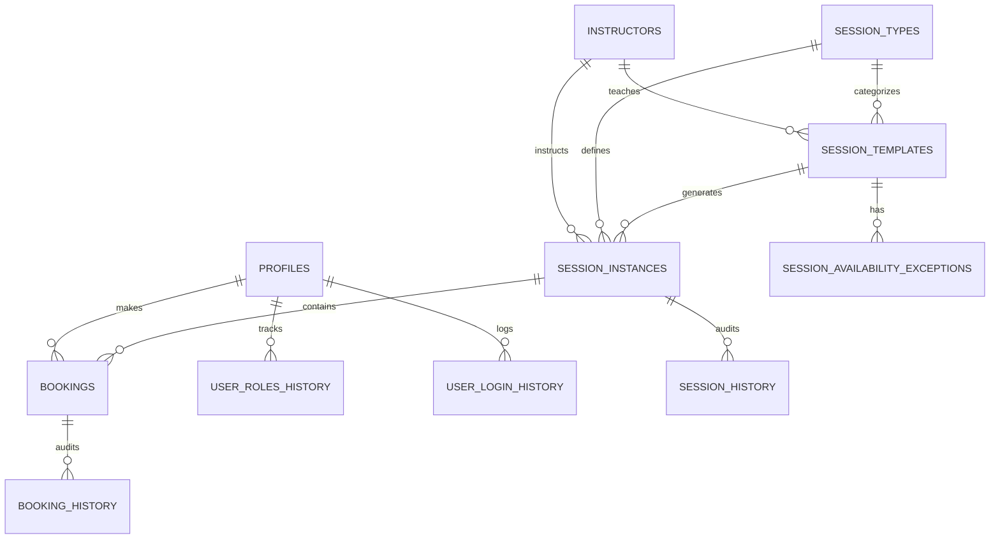
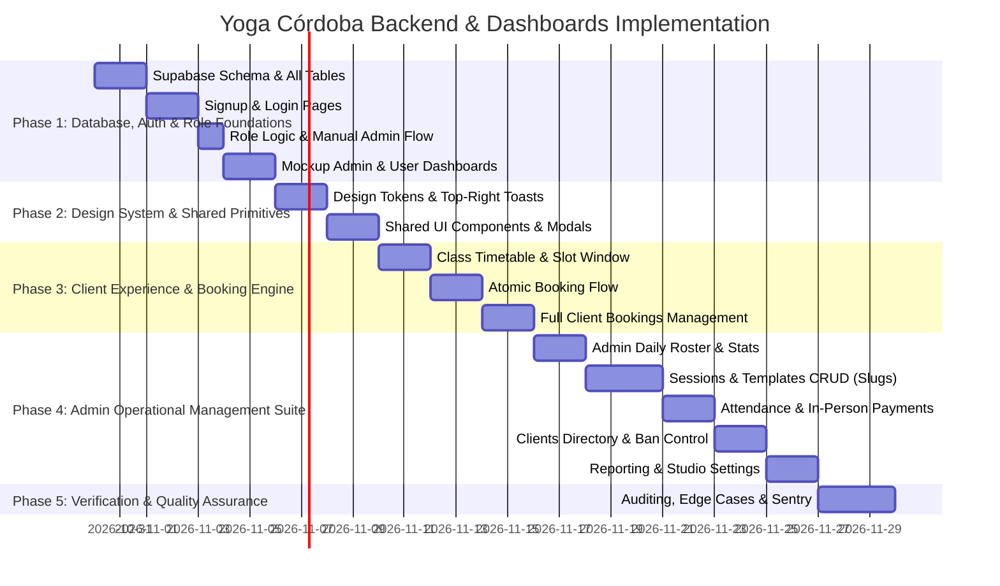

# Yoga Córdoba (TRW) — Backend & Dashboards Implementation Plan

## 1. Executive Summary & Architectural Overview

This document defines the comprehensive architecture and implementation plan for adding a Supabase-powered backend, multi-role authentication system, and dedicated Admin & Client dashboards to the existing **Yoga Córdoba** web application.

### Key Tenets

1. **Supabase Core**: PostgreSQL database with Row Level Security (RLS), Supabase Auth, Storage Buckets, and Edge Functions for recurring calendar logic and audit automation.
2. **On-Premise Payment Model**: All bookings are reserved online, but client payments are completed in person on premises (cash/card at studio). Database and UI support full tracking (`pending_on_premise`, `paid_on_premise`, `waived`, `refunded`).
3. **Role Lifecycle**:
   - `user`: Registered account that hasn't booked any session yet.
   - `client`: Automatically promoted upon completing their first session booking.
   - `admin`: Full studio operational management.
   - User status safeguards: `active`, `banned`, or `rejected`.
4. **Dedicated Slugs over Modals**: All complex forms and views use unique route slugs, implemented as Next.js App Router file-system routes (e.g., `app/admin/sessions/new/page.tsx`, `app/admin/sessions/[id]/edit/page.tsx`, `app/client/bookings/[id]/page.tsx`). Modals are reserved exclusively for critical action confirmations and rapid inline field updates.
5. **Top-Right Toasts & Shadcn Aesthetics**: System notifications surface via top-right screen toasts with high-fidelity styling adhering to our custom brand palette (`ink`, `sage`, `clay`, `ivory`).

---

## 2. Technology Stack & Dependencies

```mermaid
graph TD
    Client[Next.js 16 App Router · React 19 RSC] --> Router[File-system routing · layouts · route groups]
    Client --> UI[Tailwind CSS + Shadcn Primitives + Lucide Icons]
    Client --> Toast[Sonner - Top Right]
    Client --> SupabaseClient[@supabase/supabase-js · NEXT_PUBLIC_* env]
    SupabaseClient --> Auth[Supabase Auth - JWT]
    SupabaseClient --> DB[(PostgreSQL + RLS)]
    SupabaseClient --> Storage[Supabase Storage Buckets]
    DB --> Edge[Supabase Edge Functions / Triggers]
```

### Current Foundation (Already Migrated)

The landing page already runs on **Next.js 16 (App Router)** with Turbopack, React 19, and Tailwind CSS. The document shell is owned by `src/app/layout.tsx` (metadata, fonts, and a no-flash theme/language script). `src/lib/supabase.ts` reads `NEXT_PUBLIC_SUPABASE_URL` / `NEXT_PUBLIC_SUPABASE_ANON_KEY`. Theme + language (`es`/`en`) are managed client-side via `PrefContext` and the `usePreferences` hook, persisted in `localStorage`.

### New Packages to Add

- `sonner`: Toast notification library positioned at `top-right`, easily styled with Tailwind.
- `@radix-ui/react-dialog`, `@radix-ui/react-dropdown-menu`, `@radix-ui/react-select`, `@radix-ui/react-popover`: Accessible primitives matching Shadcn pattern.
- `date-fns`: Date manipulation and recurrence handling for session schedules.
- `recharts`: Lightweight data visualization for Admin reporting and occupancy metrics.
- `@sentry/nextjs`: Next.js-native Sentry SDK (replaces the Vite-era `@sentry/react` setup) — initialized via `next.config.ts` instrumentation and `NEXT_PUBLIC_SENTRY_DSN`.

---

## 3. Database Schema & RLS Policies (PostgreSQL)

### 3.1 Custom Types & Enums

The following PostgreSQL enums are retained for core system states and operational lifecycles:

```sql
CREATE TYPE user_role AS ENUM ('user', 'client', 'admin');
CREATE TYPE user_status AS ENUM ('active', 'banned', 'rejected');
CREATE TYPE booking_status AS ENUM ('confirmed', 'cancelled', 'attended', 'no_show', 'waitlisted');
CREATE TYPE payment_status AS ENUM ('pending_on_premise', 'paid_on_premise', 'waived', 'refunded');
CREATE TYPE session_status AS ENUM ('scheduled', 'in_progress', 'completed', 'cancelled');
CREATE TYPE recurrence_type AS ENUM ('weekly', 'biweekly', 'custom_dates');
```

> [!IMPORTANT]
> **No Enum for Session Types / Class Categories**:
> Class categories and session types are deliberately **not** defined as an enum. Instead, class types are managed dynamically via the `session_types` table. This allows authorized studio administrators to create, update, and deactivate class offerings at any time (e.g., _Yoga, Yoga Aéreo, Meditación, Pilates Suelo, Pilates Reformer, Pilates Terapéutico, Yoga Terapéutico, Entrenamiento de Fuerza_, etc.) directly from the admin dashboard without requiring database migrations or code redeployment.

---

### 3.2 Tables & Relationships



#### `profiles` (User Profiles & Role Management)

- `id` (UUID, PK, references `auth.users.id` on delete cascade)
- `role` (`user_role`, default `'user'`, not null)
- `status` (`user_status`, default `'active'`, not null)
- `full_name` (TEXT, not null)
- `phone` (TEXT)
- `avatar_url` (TEXT)
- `preferred_lang` (VARCHAR(5), default `'es'`)
- `emergency_contact_name` (TEXT)
- `emergency_contact_phone` (TEXT)
- `health_notes` (TEXT)
- `first_booking_at` (TIMESTAMPTZ)
- `created_at` (TIMESTAMPTZ, default `now()`)
- `updated_at` (TIMESTAMPTZ, default `now()`)
  > include address lines and phone number as standard in our days (add1, add2, post code, city, county, country, then phone number prefix + number)

#### `user_roles_history` (Audit Log for Role & Status Changes)

- `id` (UUID, PK, default `gen_random_uuid()`)
- `user_id` (UUID, references `profiles.id` on delete cascade, not null)
- `changed_by` (UUID, references `profiles.id`) -- NULL if automated system promotion
- `old_role` (`user_role`)
- `new_role` (`user_role`)
- `old_status` (`user_status`)
- `new_status` (`user_status`)
- `reason` (TEXT)
- `created_at` (TIMESTAMPTZ, default `now()`)

#### `user_login_history` (Login & Security Audit)

- `id` (UUID, PK, default `gen_random_uuid()`)
- `user_id` (UUID, references `profiles.id` on delete cascade, not null)
- `ip_address` (INET)
- `user_agent` (TEXT)
- `logged_at` (TIMESTAMPTZ, default `now()`)
- `status` (VARCHAR(20)) -- `'success'`, `'failed'`, `'blocked_banned'`

#### `session_types` (Dynamic Class Offerings & Categories)

_Managed dynamically by authorized admins. Never hardcoded as an enum._

- `id` (UUID, PK, default `gen_random_uuid()`)
- `name` (TEXT, not null) -- primary display name (e.g. "Yoga", "Yoga Aéreo", "Meditación", "Pilates Suelo", "Pilates Reformer", "Pilates Terapéutico", "Yoga Terapéutico", "Entrenamiento de Fuerza")
- `name_es` (TEXT, not null) -- Spanish localized name
- `name_en` (TEXT) -- English localized name
- `slug` (TEXT, unique, not null) -- e.g. `'pilates-reformer'`, `'yoga-aereo'`
- `description` (TEXT) -- detailed description of practice, benefits, and requirements
- `description_es` (TEXT)
- `description_en` (TEXT)
- `default_duration` (INTEGER, not null, default 60) -- standard session duration in minutes
- `default_capacity` (INTEGER, not null, default 12) -- default maximum attendee capacity
- `intensity_level` (TEXT) -- e.g. "Suave", "Medio", "Avanzado", "Multinivel"
- `accent_color` (TEXT, default `'sage'`) -- brand accent pill (`'sage'` | `'clay'`)
- `image_url` (TEXT) -- cover image stored in `session-media` bucket
- `is_active` (BOOLEAN, not null, default `true`) -- active/inactive status flag (deactivation preserves historical sessions while hiding from new schedules)
- `created_at` (TIMESTAMPTZ, default `now()`)
- `updated_at` (TIMESTAMPTZ, default `now()`)

#### `instructors` (Studio Instructors)

- `id` (UUID, PK, default `gen_random_uuid()`)
- `name` (TEXT, not null)
- `bio_es` (TEXT)
- `bio_en` (TEXT)
- `photo_url` (TEXT)
- `specialties` (TEXT[])
- `is_active` (BOOLEAN, default `true`)
- `created_at` (TIMESTAMPTZ, default `now()`)

#### `session_templates` (Calendar Availability & Recurrence Rules)

- `id` (UUID, PK, default `gen_random_uuid()`)
- `session_type_id` (UUID, references `session_types.id` on delete restrict, not null)
- `instructor_id` (UUID, references `instructors.id`, not null)
- `day_of_week` (SMALLINT, not null) -- 0 = Sunday, 1 = Monday, ..., 6 = Saturday
- `start_time` (TIME, not null)
- `duration_minutes` (INTEGER, not null, default 60) -- inherits default from `session_types.default_duration` if not overridden
- `max_slots` (INTEGER, not null, default 12) -- inherits default from `session_types.default_capacity` if not overridden
- `price` (DECIMAL(10,2), not null, default 12.00)
- `is_ongoing` (BOOLEAN, default `true`) -- ongoing indefinitely or date bounded
- `valid_from` (DATE, default `CURRENT_DATE`)
- `valid_until` (DATE) -- NULL if ongoing
- `is_active` (BOOLEAN, default `true`)
- `created_at` (TIMESTAMPTZ, default `now()`)
- `updated_at` (TIMESTAMPTZ, default `now()`)
  > Recurrence rule? (rule format for recurring availability) should we use a json for this instead?

#### `session_availability_exceptions` (Blackouts & Schedule Overrides)

- `id` (UUID, PK, default `gen_random_uuid()`)
- `session_template_id` (UUID, references `session_templates.id` on delete cascade, not null)
- `exception_date` (DATE, not null)
- `is_cancelled` (BOOLEAN, default `false`)
- `override_start_time` (TIME)
- `override_instructor_id` (UUID, references `instructors.id`)
- `override_max_slots` (INTEGER)
- `reason` (TEXT)
- `created_at` (TIMESTAMPTZ, default `now()`)

#### `session_instances` (Individual Scheduled Class Sessions)

_Represents a specific, bookable session occurrence on the studio calendar (e.g., Tuesday 2026-10-27 at 18:00)._

- `id` (UUID, PK, default `gen_random_uuid()`)
- `session_template_id` (UUID, references `session_templates.id` on delete set null) -- NULL for single/ad-hoc workshops
- `session_type_id` (UUID, references `session_types.id` on delete restrict, not null) -- references the dynamic session type ID
- `instructor_id` (UUID, references `instructors.id`, not null)
- `session_date` (DATE, not null)
- `start_time` (TIME, not null)
- `end_time` (TIME, not null)
- `title` (TEXT, not null) -- populated from `session_types.name`, customizable for special events
- `description` (TEXT)
- `max_slots` (INTEGER, not null) -- initialized from `session_types.default_capacity` or template
- `booked_count` (INTEGER, default 0, not null) -- tracked atomically to prevent overbooking
- `price` (DECIMAL(10,2), not null)
- `status` (`session_status`, default `'scheduled'`, not null)
- `cancel_reason` (TEXT)
- `cancelled_at` (TIMESTAMPTZ)
- `created_at` (TIMESTAMPTZ, default `now()`)
- `updated_at` (TIMESTAMPTZ, default `now()`)

#### `session_history` (Audit Log for Class Alterations & Cancellations)

- `id` (UUID, PK, default `gen_random_uuid()`)
- `session_instance_id` (UUID, references `session_instances.id` on delete cascade, not null)
- `changed_by` (UUID, references `profiles.id`)
- `action` (TEXT) -- `'created'`, `'rescheduled'`, `'cancelled'`, `'capacity_adjusted'`
- `details` (JSONB)
- `created_at` (TIMESTAMPTZ, default `now()`)

#### `bookings` (Client Reservations)

_Crucial: Bookings reference the individual scheduled session (`session_instances.id`), NOT just a session type._

- `id` (UUID, PK, default `gen_random_uuid()`)
- `booking_reference` (VARCHAR(12), unique, not null) -- e.g. `YOGA-2026-X9B2`
- `session_instance_id` (UUID, references `session_instances.id` on delete restrict, not null) -- foreign key to scheduled session instance
- `user_id` (UUID, references `profiles.id` on delete cascade, not null)
- `booking_status` (`booking_status`, default `'confirmed'`, not null)
- `payment_status` (`payment_status`, default `'pending_on_premise'`, not null)
- `price_at_booking` (DECIMAL(10,2), not null)
- `payment_notes` (TEXT) -- e.g. "Paid cash at reception"
- `cancelled_at` (TIMESTAMPTZ)
- `cancel_reason` (TEXT)
- `cancelled_by` (UUID, references `profiles.id`)
- `attended_at` (TIMESTAMPTZ)
- `marked_attended_by` (UUID, references `profiles.id`)
- `created_at` (TIMESTAMPTZ, default `now()`)
- `updated_at` (TIMESTAMPTZ, default `now()`)

#### `booking_history` (Audit Trail of All Booking State Transitions)

- `id` (UUID, PK, default `gen_random_uuid()`)
- `booking_id` (UUID, references `bookings.id` on delete cascade, not null)
- `changed_by` (UUID, references `profiles.id`)
- `old_booking_status` (`booking_status`)
- `new_booking_status` (`booking_status`)
- `old_payment_status` (`payment_status`)
- `new_payment_status` (`payment_status`)
- `note` (TEXT)
- `created_at` (TIMESTAMPTZ, default `now()`)

#### `studio_settings` (Global Configuration)

- `key` (TEXT, PK) -- e.g. `'booking_rules'`, `'studio_profile'`, `'notification_config'`
- `value` (JSONB, not null)
- `description` (TEXT)
- `updated_at` (TIMESTAMPTZ, default `now()`)

##### Example `booking_rules` in `studio_settings`:

```json
{
  "advance_booking_limit_days": 14, // Maximum days in advance a client can book (configurable by admin; e.g., 7, 14, 21, 30 days)
  "cancellation_cutoff_hours": 2, // Minimum hours before class start time allowed to cancel
  "max_active_bookings_per_user": 5 // Optional cap to prevent hoarding
}
```

---

### 3.3 Row Level Security (RLS) Policies

Every table has Row Level Security enabled (`ALTER TABLE ... ENABLE ROW LEVEL SECURITY`). Policies enforce strict separation of duties:

#### 1. `session_types`

- **SELECT**:
  - `Public / Authenticated`: Can view where `is_active = true` (or if joined via historical bookings).
  - `Admin`: Can view all records (both active and inactive).
- **INSERT / UPDATE / DELETE**:
  - Restricted strictly to `role = 'admin'`.
  - Deactivation (`is_active = false`) is enforced instead of physical `DELETE` when references exist in `session_instances` or `session_templates`.

```sql
-- Public/Authenticated read active session types
CREATE POLICY "Public read active session types"
ON session_types FOR SELECT
USING (is_active = true OR EXISTS (
  SELECT 1 FROM profiles WHERE profiles.id = auth.uid() AND profiles.role = 'admin'
));

-- Admin full management
CREATE POLICY "Admin manage session types"
ON session_types FOR ALL
USING (EXISTS (
  SELECT 1 FROM profiles WHERE profiles.id = auth.uid() AND profiles.role = 'admin'
));
```

#### 2. `session_instances`

- **SELECT**: Public & clients can view scheduled sessions (`status != 'cancelled'`). Admins view all sessions including cancelled.
- **INSERT / UPDATE / DELETE**: Restricted to `role = 'admin'`.

#### 3. `bookings`

- **SELECT**:
  - `Clients / Users`: Can select only their own bookings (`user_id = auth.uid()`).
  - `Admin`: Can select all bookings studio-wide.
- **INSERT**:
  - `Clients / Users`: Can insert a booking for themselves (`user_id = auth.uid()`), provided account status is `'active'` (not banned/rejected).
  - Executed through the secure transactional procedure `create_booking_atomic` to enforce slot capacity limits.
- **UPDATE**:
  - `Clients / Users`: Can update `booking_status` to `'cancelled'` for their own booking up to the policy cancellation window.
  - `Admin`: Can update any booking (mark attendance, update in-person payment status, administrative cancellation).

```sql
-- Client reads own bookings
CREATE POLICY "Client read own bookings"
ON bookings FOR SELECT
USING (user_id = auth.uid() OR EXISTS (
  SELECT 1 FROM profiles WHERE profiles.id = auth.uid() AND profiles.role = 'admin'
));

-- Client can cancel own booking
CREATE POLICY "Client cancel own booking"
ON bookings FOR UPDATE
USING (user_id = auth.uid())
WITH CHECK (user_id = auth.uid());

-- Admin full access
CREATE POLICY "Admin full booking management"
ON bookings FOR ALL
USING (EXISTS (
  SELECT 1 FROM profiles WHERE profiles.id = auth.uid() AND profiles.role = 'admin'
));
```

#### 4. `profiles`

- **SELECT**: Users can view their own profile; Admins can view all user profiles.
- **UPDATE**: Users can update their own personal info (`full_name`, `phone`, `emergency_contact_*`, `health_notes`); only Admins can alter `role` and `status`.

#### 5. Audit & History Tables (`user_roles_history`, `user_login_history`, `session_history`, `booking_history`)

- **SELECT**: Restricted to `role = 'admin'` (users may view their own login history on `/profile`).
- **INSERT**: Performed via SECURITY DEFINER triggers and server functions; direct user modifications are blocked.

---

## 4. Key Business Logic & Database Automation

### 4.1 Automated Role Promotion (`user` -> `client`)

- **Rule**: When an account with role `'user'` successfully creates their first booking, an atomic PostgreSQL trigger promotes their role to `'client'`, records `first_booking_at = now()`, and inserts an entry into `user_roles_history`.

```sql
CREATE OR REPLACE FUNCTION handle_first_booking_role_promotion()
RETURNS TRIGGER AS $$
BEGIN
  IF (SELECT role FROM profiles WHERE id = NEW.user_id) = 'user' THEN
    UPDATE profiles
    SET role = 'client',
        first_booking_at = COALESCE(first_booking_at, now()),
        updated_at = now()
    WHERE id = NEW.user_id;

    INSERT INTO user_roles_history (user_id, changed_by, old_role, new_role, reason)
    VALUES (NEW.user_id, NULL, 'user', 'client', 'Automated promotion upon first confirmed booking');
  END IF;
  RETURN NEW;
END;
$$ LANGUAGE plpgsql SECURITY DEFINER;

CREATE TRIGGER tr_first_booking_promotion
AFTER INSERT ON bookings
FOR EACH ROW
WHEN (NEW.booking_status = 'confirmed')
EXECUTE FUNCTION handle_first_booking_role_promotion();
```

### 4.2 Overbooking Protection & Capacity Locking

- A database function `create_booking_atomic(p_session_id UUID, p_user_id UUID)` executes inside an atomic transaction using `SELECT ... FOR UPDATE` on `session_instances`.
- If `booked_count >= max_slots`, it rejects with an explicit error (`CLASS_FULL`).
- Otherwise, it increments `booked_count` and creates the `bookings` record safely.

### 4.3 Advance Booking Window Validation (Configurable in Days)

To prevent clients from reserving classes months ahead (which leads to uncommitted slots, high no-show rates, and administrative friction when schedules change), a rolling **Advance Booking Limit (in Days)** is enforced both on the database level and in the UI:

- **Why Days Rather Than Weeks**: Days provide precise operational granularity (e.g., 7 days, 10 days, 14 days, 21 days, 30 days) and calculate cleanly as `session_date <= (CURRENT_DATE + advance_days)`. A weeks-based setting restricts configuration to coarse 7-day jumps.
- **Enforcement inside `create_booking_atomic`**:

```sql
-- Retrieve studio advance booking limit (default: 14 days)
SELECT COALESCE((value->>'advance_booking_limit_days')::integer, 14)
INTO v_advance_limit_days
FROM studio_settings
WHERE key = 'booking_rules';

-- Validate session date is within allowed booking window
IF v_session.session_date > (CURRENT_DATE + v_advance_limit_days) THEN
  RAISE EXCEPTION 'BOOKING_TOO_EARLY: Bookings open % days before class (available on %)',
    v_advance_limit_days, (v_session.session_date - v_advance_limit_days);
END IF;
```

- **Client UI Handling**: Classes scheduled beyond the advance window are visible on the schedule for visibility/planning, but the booking button is disabled with an explanatory chip (e.g., _"Reservas abren el DD/MM"_ / _"Opens in X days"_).

### 4.4 Ban/Reject Enforcement

- Active check in Supabase RLS and client auth state listener: If `profiles.status = 'banned'`, user tokens are rejected, queries return 403, and the user is logged out with an explanatory toast message.

---

## 5. Storage Buckets & Policies

1. **`session-media`**: Public bucket for class imagery and instructor photographs. (Admin read/write; public read).
2. **`avatars`**: Public bucket for user profile pictures. (User read/write for own folder `avatars/{user_id}/*`; public read).
3. **`studio-assets`**: Brand assets, schedule PDF downloads, receipts/waivers.

---

## 6. Detailed Route & Page Architecture

In alignment with requirements, each functional view has a distinct URL slug to ensure bookmarkability, deep linking, and a clean workflow. Modals are reserved strictly for confirmations and quick edits.

```
All routes are implemented as Next.js App Router pages under `src/app/`. Dynamic segments use the `[id]` folder convention rather than `:id` path params.

```

app/
├── page.tsx -> Main Landing Page (Existing)
├── horarios/page.tsx -> Public Live Schedule & Booking Entry
├── login/page.tsx -> Authentication Login
├── signup/page.tsx -> Authentication Signup
├── forgot-password/page.tsx -> Password Recovery Request
├── reset-password/page.tsx -> Set New Password (Auth Callback)
├── profile/page.tsx -> User Account Profile & Preferences
│
├── client/ -> CLIENT PORTAL (route group + shared layout)
│ ├── layout.tsx -> ClientLayout (top nav, booking counter)
│ ├── dashboard/page.tsx -> Upcoming classes, quick actions, stats
│ ├── bookings/page.tsx -> Full booking list (Upcoming / Past / Cancelled)
│ ├── bookings/[id]/page.tsx -> Single booking detail (Location, Calendar .ics, Cancel)
│ └── classes/page.tsx -> Browse & book upcoming available sessions
│
└── admin/ -> ADMIN PORTAL (route group + shared layout)
├── layout.tsx -> AdminLayout (sidebar, active indicators)
├── dashboard/page.tsx -> KPI Overview (Occupancy, Revenue, Pending Collections)
├── sessions/page.tsx -> Session List & Filterable Timetable
├── sessions/new/page.tsx -> Create New Session / Recurring Template
├── sessions/[id]/page.tsx -> View Session Details, Attendee List & Check-in
├── sessions/[id]/edit/page.tsx -> Edit Session Parameters, Slots, Exceptions
├── session-types/page.tsx -> CRUD Class Categories & Disciplines
├── session-types/new/page.tsx -> Create Class Category
├── session-types/[id]/edit/page.tsx -> Edit Class Category
├── bookings/page.tsx -> Master Booking Management & Check-In
├── bookings/[id]/page.tsx -> Booking Detail & Payment Collector Sheet
├── clients/page.tsx -> Client & User Directory (Roles, Bans, Approvals)
├── clients/[id]/page.tsx -> Client 360° Profile & Booking History
├── reporting/page.tsx -> Analytics, Occupancy Heatmap, Revenue Projections
├── availability/page.tsx -> Visual Studio Calendar, Holidays & Exception Planner
└── settings/page.tsx -> Studio Profile, Cancellation Policy Window, System Logs

````

---

## 7. Page-by-Page Feature Specifications

### 7.1 General & Auth Pages

- **`/login` & `/signup`**:
  - Centered split card with subtle background organic gradient.
  - Email/password authentication, validation with inline errors.
  - Automatic redirect based on role: `admin` -> `/admin/dashboard`, `client`/`user` -> `/client/dashboard`.
- **`/profile`**:
  - Personal info (Full Name, Phone Prefix + Number, Complete Address: Address Line 1, Address Line 2, Postal Code, City, County/Province, Country).
  - Emergency contact details (Contact Name, Phone Prefix + Number) & Health / Yoga experience notes.
  - Avatar image upload (via Supabase storage `avatars` bucket).
  - Language toggle (`es` / `en`) & dark/light theme selector.
  - Login history list (Recent devices, IP locations, timestamp).

### 7.2 Client Pages

- **`/client/dashboard`**:
  - **Hero Welcome Card**: Next upcoming class countdown, instructor name, room notes.
  - **Quick Stats**: Total classes attended, next booking status, payment pending reminders ("Pay on arrival").
  - **Upcoming Bookings Grid**: Cards displaying date, time, discipline, and quick buttons: "View Details" or "Cancel Booking".
  - **Quick Booking Shortcut**: One-click jump to `/client/classes`.
- **`/client/bookings` & `/client/bookings/:id`**:
  - Categorized tabs: **Upcoming**, **Past**, **Cancelled**.
  - Detail page includes:
    - Session badge, time, duration, instructor profile snippet.
    - Payment instructions: _"Pago en recepción: 12,00 € al inicio de la clase (Efectivo o tarjeta)"_.
    - "Add to Google Calendar / Apple Calendar (.ics)" button.
    - Cancel booking action (triggers confirmation modal with studio cancellation policy notice).
- **`/client/classes`**:
  - Live timetable of upcoming sessions filterable by discipline and instructor.
  - Enforces the studio's rolling advance booking window: sessions within the allowed limit (e.g., next 14 days) are immediately bookable; sessions beyond the window show an informative countdown badge (e.g., *"Reservas abren el DD/MM"* / *"Opens in X days"*).
  - Direct atomic booking action invoking `create_booking_atomic` with immediate top-right toast feedback.

### 7.3 Admin Pages

- **`/admin/dashboard`**:
  - **Studio Health Bar**: Today's sessions count, today's total booked yogis, occupancy percentage, pending in-person payments.
  - **Today's Live Timetable**: Real-time view of classes happening today with check-in progress bars (`booked / max_slots`).
  - **Recent Booking Activity**: Live feed of latest reservations, cancellations, and new user registrations.
- **`/admin/sessions` & `/admin/sessions/:id`**:
  - Data table with date filters, discipline filters, instructor filters.
  - Direct status toggling (`scheduled`, `completed`, `cancelled`).
  - Session Detail page (`/admin/sessions/:id`):
    - Real-time roster of attendees.
    - One-click check-in toggle ("Attended" / "No-Show").
    - One-click payment collected toggle ("Paid on Premise" / "Pending").
    - Cancel session action with required reason input (modal confirmation).
- **`/admin/bookings`**:
  - Searchable by client name, email, booking reference code, or date.
  - Bulk actions (Mark paid, export CSV).
  - Inline payment status updater modal.
- **`/admin/clients` & `/admin/clients/:id`**:
  - Directory of all registered users with filter by role (`user`, `client`, `admin`) and status (`active`, `banned`).
  - Client Detail page (`/admin/clients/:id`):
    - Profile details, emergency contact, health notes.
    - Lifetime stats: Total bookings, attendance rate, total spent on premises.
    - Action buttons: "Change Role", "Ban User", "Send Note".
- **`/admin/availability`**:
  - Weekly recurring template manager.
  - Calendar exception picker (Mark studio closed on holidays or substitute instructors).
- **`/admin/reporting`**:
  - Metrics: Monthly occupancy %, most popular disciplines/instructors, cancellation rate, estimated collected revenue.
  - Charts built with accessible Tailwind-themed SVG/Recharts.
- **`/admin/settings`**:
  - Studio contact info, opening hours, default slot limits.
  - **Booking Rules Configuration**:
    - **Advance Booking Limit (in Days)**: Number input (default `14` days; controls rolling horizon clients can book ahead).
    - **Late Cancellation Cutoff (in Hours)**: Number input (default `2` hours; window within which cancellations flag as late).
    - **Max Active Bookings Per Client**: Number input (optional limit to prevent slot hoarding).
  - Toast notification preferences & audit log viewer.

---

## 8. Brand & Design System Guide (Yoga Córdoba)

The new backend and dashboard interfaces must feel seamless and harmonious with the existing serene, high-end landing page.

### 8.1 Color Palette Tokens

| Token       | Hex Range                                         | Semantic Purpose                                                              |
| ----------- | ------------------------------------------------- | ----------------------------------------------------------------------------- |
| **`ivory`** | `ivory-50` (`#fbfdfc`) to `ivory-100` (`#f5faf8`) | Primary light background, cards, clean canvas                                 |
| **`ink`**   | `ink-950` (`#111a1c`) to `ink-700` (`#344e4b`)    | Dark mode background (`ink-950`), primary text (`ink-900`), borders           |
| **`sage`**  | `sage-600` (`#37837b`) to `sage-500` (`#4c9e93`)  | Primary brand color, confirmed status, main action buttons, active navigation |
| **`clay`**  | `clay-500` (`#3fa898`), terracotta tints          | Alerts, urgency indicators, full capacity badges, cancellation states         |

### 8.2 Typography

- **Headings & Page Titles**: `font-display` (`Fraunces`, warm serif) for an organic, mindful, premium aesthetic.
- **Body, Inputs, Data Tables, KPIs**: `font-sans` (`Inter`) for crisp legibility and data density.

### 8.3 UI Components (Shadcn Style Guidelines)

- **Buttons**:
  - _Primary_: `bg-sage-600 hover:bg-sage-700 text-white rounded-full font-semibold shadow-sm transition-all`
  - _Secondary / Outline_: `border border-sage-300 dark:border-ink-600 text-ink-700 dark:text-ivory-200 rounded-full hover:bg-sage-50 dark:hover:bg-ink-800`
  - _Destructive_: `bg-clay-600 hover:bg-clay-700 text-white rounded-full font-semibold`
- **Cards**: `rounded-2xl border border-sage-200/60 bg-ivory-50/90 dark:border-ink-700 dark:bg-ink-800/90 backdrop-blur-md shadow-sm`
- **Data Tables**: Rounded outer container, subtle row dividers (`border-sage-200/40`), alternating hover states, sticky header.
- **Screen Toasts**:
  - Fixed position: **Top Right** (`top-5 right-5`).
  - Styling: Glassmorphism surface with `border-sage-300 dark:border-ink-600`, colored accent pill, close button, slide-in from top-right animation.
- **Modals vs Slugs Rule**:
  - **Slugs (Dedicated Routes)**: Creation forms, editing forms, details with multiple tabs or extensive tables.
  - **Modals (Dialogs)**: Small prompt confirmations (e.g., "Confirm cancellation?", "Mark paid in cash?").

---

## 9. Step-by-Step Implementation Roadmap



### Phase 1: Database Setup, Auth & Mockup Dashboards

#### Overview
This phase establishes the foundational Supabase database architecture with all required tables and enums first, implements the signup and login pages, sets up user role handling (with support for manual admin elevation in Supabase), and builds mockup admin and user dashboards to immediately test the authentication lifecycle and role-based access.

#### 1. Supabase Setup & Full Database Migration
- [ ] **Client & Environment Verification**:
  - Verify `@supabase/supabase-js` installation and configure `src/lib/supabase.ts`.
  - Validate environment variables (`NEXT_PUBLIC_SUPABASE_URL`, `NEXT_PUBLIC_SUPABASE_ANON_KEY`).
- [ ] **Database Schema & Table Creation**:
  - Create all enums: `user_role` (`user`, `client`, `admin`), `user_status` (`active`, `banned`, `rejected`), `booking_status`, `payment_status`, `session_status`, `recurrence_type`.
  - Create all core tables with constraints:
    - `profiles` (`id`, `first_name`, `last_name`, `phone_number`, `role`, `status`, etc.)
    - `instructors`
    - `session_types`
    - `session_templates`
    - `session_instances`
    - `bookings`
    - `calendar_exceptions`
    - `user_roles_history`
    - `user_login_history`
    - `audit_logs`
  - Establish Row Level Security (RLS) policies and triggers (`handle_new_user` profile auto-creation with default `user` role).

#### 2. Authentication Flow (Signup & Login Pages)
- [ ] **Global Auth Context**:
  - Implement `src/context/AuthContext.tsx` handling session synchronization, profile retrieval, role resolution, and sign-out.
- [ ] **Signup Page**:
  - Build `src/app/auth/signup/page.tsx` with email, password, first name, last name, and phone.
  - Test registration creating a user in Supabase Auth and corresponding `profiles` row.
- [ ] **Login Page**:
  - Build `src/app/auth/login/page.tsx` with email/password authentication and error messaging.

#### 3. User Roles & Admin Setup
- [ ] **Role Resolution & Access Control**:
  - Implement role helper utilities and Next.js App Router layout guards / middleware for role-based redirects (`user`/`client` vs `admin`).
- [ ] **Manual Admin Provisioning**:
  - Provide clear steps / SQL script to manually promote the first account to `admin` in the Supabase console (`UPDATE profiles SET role = 'admin' WHERE email = ...`).

#### 4. Mockup Admin & User Dashboards (Testing Shells)
- [ ] **Mockup User / Client Dashboard**:
  - Create `/client/dashboard` (or `/(dashboard)/user/page.tsx`):
    - Display current user profile details, active role badge (`user` or `client`), and quick logout.
    - Placeholder booking card to verify view rendering for authenticated users.
- [ ] **Mockup Admin Dashboard**:
  - Create `/admin/dashboard`:
    - Display admin identity, role guard confirmation, and overview cards (Total Yogis, Today's Classes, Studio Stats placeholders).
    - Quick role verification panel to ensure non-admins cannot access this route.
- [ ] **End-to-End Verification**:
  - Sign up a new user -> Verify they land on User Dashboard with `user` role.
  - Attempt accessing `/admin/dashboard` as regular user -> Verify access denied / redirect.
  - Manually elevate to `admin` in Supabase -> Log in as admin -> Verify direct access to Admin Dashboard.

---

### Phase 2: Design System, Layouts & Top-Right Toasts

#### 1. Notification System
- [ ] Install and configure `sonner` with top-right positioning (`position="top-right"`).
- [ ] Custom styling adhering to TRW brand palette (`sage`, `clay`, `ink`, `ivory`).

#### 2. Shared UI Components (Shadcn pattern)
- [ ] Accessible primitives: `Button`, `Input`, `Select`, `Dialog`, `Badge`, `Card`, `Table`.
- [ ] Light & dark mode parity with CSS variables and Tailwind.

#### 3. Navigation Shells
- [ ] **Admin Layout**: Collapsible sidebar, active route highlights, studio info, user avatar.
- [ ] **Client Layout**: Streamlined top navigation, active booking badge, quick profile menu.

---

### Phase 3: Client Experience & Booking Flow

#### 1. Public Class Schedule
- [ ] Live timetable displaying upcoming sessions filtered by discipline and instructor.
- [ ] 14-day rolling advance booking window countdown indicators for future sessions.

#### 2. Atomic Booking Flow
- [ ] Wire atomic reservation via `create_booking_atomic` Postgres function.
- [ ] Automatic promotion of user to `client` role upon first reservation.
- [ ] In-person payment model (`pending_on_premise`).

#### 3. Client Dashboard & Bookings
- [ ] `/client/dashboard`: Next class countdown, studio announcements, quick cancel.
- [ ] `/client/bookings` and `/client/bookings/[id]`: Booking details, status badge, calendar `.ics` download, payment guidance.

---

### Phase 4: Admin Operational Management Suite

#### 1. Operational Overview
- [ ] `/admin/dashboard`: Studio health metrics (occupancy %, today's check-ins, pending payments).
- [ ] Live daily class roster with progress counters.

#### 2. Sessions Management (Slug-based Routes)
- [ ] `/admin/sessions`: Filterable sessions data table.
- [ ] `/admin/sessions/new`: New session instance creation form.
- [ ] `/admin/sessions/[id]/edit`: Session edit route.
- [ ] `/admin/sessions/[id]`: Detailed session roster, one-click attendance ("Attended"/"No-Show"), and payment toggle ("Paid on Premise").

#### 3. Availability & Blackout Dates
- [ ] `/admin/availability`: Weekly recurring template manager and holiday exception calendar.

#### 4. Client Directory & Role Control
- [ ] `/admin/clients` & `/admin/clients/[id]`: User directory, lifetime stats, role adjustment, and ban enforcement.

#### 5. Reporting & Studio Configuration
- [ ] `/admin/reporting`: Occupancy, popular classes, and projected revenue charts.
- [ ] `/admin/settings`: Advance booking limits, cancellation cutoff hours, max active bookings.

---

### Phase 5: Verification, Auditing & Hardening

- [ ] Multi-role authorization checks and immediate ban session invalidation.
- [ ] Concurrency and double-booking stress testing.
- [ ] Sentry error boundary coverage across all routes.
- [ ] Responsive UI verification across mobile, tablet, and desktop.

---

## 10. Verification & Quality Assurance Strategy

- **Role Transition Test**: Create a new test user (`user`), verify restricted access to past history until a session is booked, confirm instant automatic elevation to `client`.
- **Ban Enforcement Test**: Mark user `banned` from admin console, verify immediate session termination and rejection of all subsequent actions.
- **Concurrency Test**: Simulate simultaneous bookings when `remaining_slots = 1` to confirm database locks prevent overselling.
- **In-Person Payment Reconciliation**: Verify that uncollected payments clearly flag as "Pending on Premise" on both the client dashboard and the admin daily check-in sheet.
- **Top-Right Toast Verification**: Confirm all success/error toasts display cleanly in top-right without obscuring key navigation controls.
