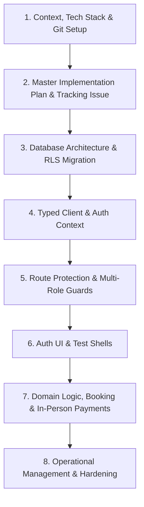

# Reusable App Blueprint & Engineering Playbook (SKILL_BUILDING)

> **Purpose**: This document captures the battle-tested architectural patterns, execution sequence, security guardrails, and lessons learned from building the **Yoga Córdoba (TRW)** backend and dashboards.
> 
> When starting any new project or web application with an AI agent (or pair programmer), you can feed or reference this file. The agent will read this playbook, understand the exact sequence of steps, and apply the same high standard without repeating past mistakes.

---

## 1. How Professional Teams & AI Agents Manage Reusability

When scaling across multiple projects, leading engineering teams use a **layered playbook system**:
1. **The Project Blueprint (`SKILL_BUILDING.md` / `ARCHITECTURE_PLAYBOOK.md`)**: A high-level playbook in the repo outlining architecture rules, security invariants, and step-by-step lifecycles.
2. **The Execution Plan (`IMPLEMENTATION_PLAN.md`)**: A living, checklist-based roadmap specific to the app's domain and roadmap phases.
3. **The Issues / PR Protocol (`GITHUB_ISSUES_GUIDE.md`)**: Standardized branch, commit, and tracking practices for AI agents so no untracked work occurs.
4. **Agent Skill / Rules**: When using tools like Antigravity, Cursor, or Claude Code, rules or skills can point to this document so the AI automatically adopts these habits at kickoff.

---

## 2. Standard End-to-End Project Lifecycle

Whenever starting a new greenfield or transitional project, follow this exact sequence:



---

## 3. Step-by-Step Blueprint (Phases & Checklist)

### Step 1: Foundation & Git Protocol
- [ ] Define repo owner, branch names, and issue tracking protocol (`feat/issue-X-description`).
- [ ] Create `.env.example` with clear documentation of required secrets vs public keys.
- [ ] Ensure `.gitignore` ignores `.env`, `.env.local`, `.next`, and build artifacts.
- [ ] Create initial tracking issue on GitHub before writing code.

### Step 2: Architecture & Implementation Plan
- [ ] Write a comprehensive `IMPLEMENTATION_PLAN.md`:
  - Executive summary and core tenets (e.g. on-premise payment, role promotion, slug-based routes over modals).
  - ERD diagram of tables and relationships.
  - Step-by-step phased roadmap with checkboxes (`- [ ]`).
  - Strict rule: **Never write code until the roadmap and issue are aligned**.

### Step 3: Supabase & Database Architecture
- [ ] Create dedicated SQL migration file under `supabase/migrations/` (e.g., `YYYYMMDD_000001_initial_schema.sql`).
- [ ] Define database enums (`user_role`, `user_status`, domain statuses).
- [ ] Build core tables with sensible defaults and foreign key cascades/restrictions:
  - `profiles` referencing `auth.users(id)` ON DELETE CASCADE.
  - Domain tables (e.g. `instructors`, `session_types`, `session_templates`, `session_instances`, `bookings`).
  - Audit log tables (`user_roles_history`, `user_login_history`, `audit_logs`).
- [ ] **Crucial Trigger — Profile Auto-Creation**:
  ```sql
  CREATE OR REPLACE FUNCTION public.handle_new_user()
  RETURNS TRIGGER AS $$
  BEGIN
    INSERT INTO public.profiles (id, role, status, full_name)
    VALUES (NEW.id, 'user', 'active', COALESCE(NEW.raw_user_meta_data->>'full_name', SPLIT_PART(NEW.email, '@', 1)))
    ON CONFLICT (id) DO NOTHING;
    RETURN NEW;
  END;
  $$ LANGUAGE plpgsql SECURITY DEFINER;
  ```
- [ ] **Row Level Security (RLS)**:
  - Enable RLS on all tables (`ALTER TABLE ... ENABLE ROW LEVEL SECURITY;`).
  - Read & write policies for individual users (`auth.uid() = id` or `user_id = auth.uid()`).

### Step 4: Security Invariants & Pitfalls Avoided (Critical Lessons)

> [!CAUTION]
> #### Lesson 1: PostgreSQL RLS Infinite Recursion
> **Mistake**: Writing an admin policy like `EXISTS (SELECT 1 FROM profiles WHERE id = auth.uid() AND role = 'admin')` directly on the `profiles` table causes PostgreSQL to evaluate the policy when querying `profiles`, triggering an infinite recursion loop and breaking all profile queries.
> 
> **Solution**: Always use a separate `SECURITY DEFINER` helper function with `STABLE`:
> ```sql
> CREATE OR REPLACE FUNCTION public.is_admin(p_user_id UUID DEFAULT auth.uid())
> RETURNS BOOLEAN AS $$
> BEGIN
>   RETURN EXISTS (
>     SELECT 1 FROM public.profiles
>     WHERE id = p_user_id AND role = 'admin'
>   );
> END;
> $$ LANGUAGE plpgsql SECURITY DEFINER STABLE;
> 
> -- Then use it cleanly in policies:
> CREATE POLICY "Users read own profile or admin reads all"
>   ON public.profiles FOR SELECT
>   USING (auth.uid() = id OR public.is_admin());
> ```

> [!WARNING]
> #### Lesson 2: Next.js Navigation History Trapping
> **Mistake**: Using `router.push('/unauthorized')` when a user lacks permissions traps the user in a back-button loop. Clicking "back" in the browser lands on the forbidden route, which pushes `/unauthorized` again.
> 
> **Solution**: Always use `router.replace(forbiddenRedirectTo)` for security redirects so the forbidden page is never pushed onto the browser history stack.

> [!NOTE]
> #### Lesson 3: Next.js Smooth Scrolling Attribute
> When using `scroll-smooth` on `<html>`, Next.js route transitions can slide slowly or jitter. Always add `data-scroll-behavior="smooth"` to the `<html>` element in Next.js App Router:
> ```tsx
> <html lang="es" className="scroll-smooth" data-scroll-behavior="smooth">
> ```

### Step 5: Frontend Auth Context & Route Guards
- [ ] **Typed Database**:
  - Export full schema interfaces in `src/types/database.ts` representing `Row`, `Insert`, and `Update` types.
  - Instantiate typed client in `src/lib/supabase.ts`: `createClient<Database>(url, key)`.
- [ ] **Global Auth Context** (`src/context/AuthContext.tsx`):
  - Listens to `supabase.auth.onAuthStateChange`.
  - Resolves `user`, `session`, `profile`, `role`, `status`, and helper flags (`isAdmin`, `isClient`).
  - Provides a `refreshProfile()` helper so edits immediately propagate across the app.
- [ ] **Protected Route Guard** (`src/components/auth/ProtectedRoute.tsx`):
  - If unauthenticated $\rightarrow$ `router.replace('/auth/login')`.
  - If role not in `allowedRoles` $\rightarrow$ `router.replace('/unauthorized')`.
  - Role-specific layouts (`src/app/admin/layout.tsx` for admin, `src/app/client/layout.tsx` for students).

### Step 6: Core User & Admin Dashboards (MVP Shells)
- [ ] **User Dashboard (`/client/dashboard`)**:
  - Displays user profile status, current role (`user` vs `client`), and quick action buttons.
  - Automatic redirect: If an `admin` user navigates to `/client/*`, they are redirected to `/admin/dashboard`.
- [ ] **Admin Control Center (`/admin/dashboard`)**:
  - Operational banner with active status indicator and identity.
  - Live database KPIs (Total Revenue, New Clients, Active Sessions, Pending Requests).
  - Recent bookings list and live terminal system logs.
- [ ] **Unauthorized 403 Page (`/unauthorized`)**:
  - Clean error page explaining insufficient permissions with links to `/client/dashboard` or `/`.

### Step 7: Universal Profile Page & Header Avatar Dropdown
- [ ] **Universal Profile Page (`/profile`)**:
  - Accessible to all authenticated users (`user`, `client`, `admin`).
  - Personal info (name, email, international phone).
  - Address fields (lines 1 & 2, postal code, city, province, country).
  - Health & emergency contacts (crucial for studios, gyms, or healthcare apps).
  - Live save with `refreshProfile()`.
- [ ] **Header User Dropdown**:
  - Logged out: Clean "Log in" button.
  - Logged in: Avatar pill with user image or initials placeholder (e.g., `EG`).
  - Dropdown menu with outside-click dismissal:
    - User identity & role badge.
    - Profile link (`/profile`).
    - Dashboard link (dynamically points to `/admin/dashboard` or `/client/dashboard`).
    - Clean Sign Out button.

---

## 4. How to Prompt an AI Agent on a New Project Using this File

When you begin your next app, start your prompt like this:

> *"Hello! We are starting a new application. Please inspect `Implementation/SKILL_BUILDING.md` in this repository and adhere strictly to its execution lifecycle, security invariants, and coding standards. 
> Let's begin with Step 1 and Step 2: setting up the tracking issue, verifying context, and generating our master implementation plan before writing any code."*

This guarantees that:
1. The AI builds a clear implementation plan first.
2. The database is designed with proper enums, auto-triggers, and non-recursive RLS security.
3. The authentication context, role guards, and profile management follow this exact verified pattern.
4. Checklists are kept up-to-date at every milestone.

